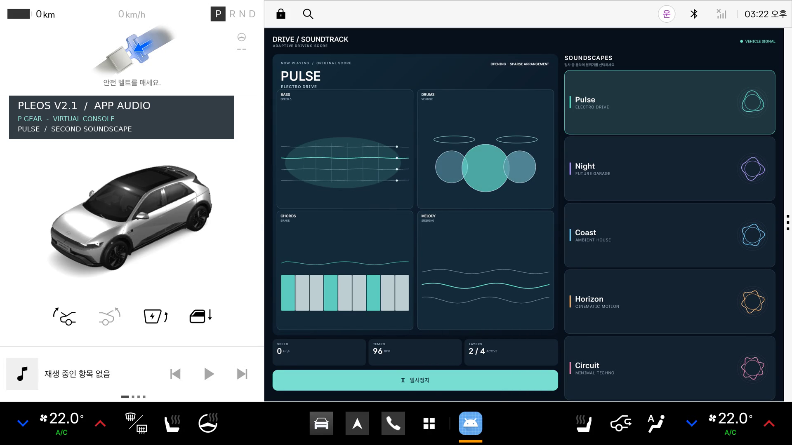

# Drive Soundtrack

전기차의 조용한 실내에서 차량 조작이 악기를 연주하는 경험을 제안하는 Android Automotive용 오리지널 음악 앱입니다. 속도는 드럼, 가속 페달 또는 속도 변화는 베이스, 브레이크는 화성, 조향은 선율, 방향지시등은 짧은 응답, 와이퍼는 질감에 반영합니다. 다섯 사운드스케이프를 음원 파일이나 네트워크 없이 실시간 합성합니다. **앱 기능은 모두 Kotlin**이며, 화면은 Android View로 구현했습니다.

[전기차 제품 근거와 검증 범위](EV_PRODUCT_RATIONALE.md) · [악기 중심 기획](PRODUCT_V2_INSTRUMENT_CONCEPT.md) · [시각 콘셉트](demo/instrument-stage-v2-concept.png)

## 시연 영상

[](https://hoyadong1.github.io/DriveSoundtrack/)

[GitHub Pages에서 영상 바로 재생](https://hoyadong1.github.io/DriveSoundtrack/) · [MP4 파일](docs/drive-soundtrack-demo.mp4) · [서명된 release APK 다운로드](apk/홍원택_DriveSoundtrack_release.apk)

**0.3.0 · 약 62초 시연.** Pleos Connect v2.1.0 전체 화면에서 왼쪽 3D 차량과 오른쪽 악기 무대를 함께 보여 줍니다. P 기어의 에뮬레이터 Virtual Console에서 정차, 속도 35 km/h, 속도 55 km/h와 브레이크 70%, 속도 36 km/h와 조향 150°, 좌측 방향지시등을 각각 짧은 장면으로 녹화해 연결했습니다. 마지막은 정차 상태의 Pulse입니다. 방향지시등 장면에 뜨는 측면 카메라는 Pleos 화면입니다. **음악은 각 화면을 녹화하는 동안 실제 앱이 `AudioTrack.write()`에 전달한 PCM을 디버그 빌드에서 WAV로 기록해 합쳤습니다.** 에뮬레이터의 시스템 오디오 캡처가 무음이어서 앱 재생 경로에서 직접 기록했습니다. 스피커 출력의 루프백 녹음은 아닙니다. [0.3.0 다섯 모드 음악 미리듣기](docs/drive-soundtrack-soundscapes.mp3)

## 기능

- Pulse(일렉트로), Night(퓨처 개러지), Coast(앰비언트 하우스), Horizon(시네마틱), Circuit(미니멀 테크노)의 다섯 사운드스케이프
- 각 모드의 16단계 리듬 패턴, 4마디 화성 순환, 선율 변화와 스테레오 딜레이. 속도의 BPM 영향은 최대 6 BPM으로 제한하고 악기마다 서로 다른 차량 신호를 반영
- Android Automotive `PERF_VEHICLE_SPEED`, 선택적 `ACCELERATOR_PEDAL_COMPRESSION_PERCENTAGE`, Pleos Vehicle SDK Brake·SteeringWheel·TurnSignal·Wiper·DrivingMode 읽기 전용 입력
- 가속 페달 속성이 없는 기기에서는 **속도 변화로 추정한 추진감**을 베이스에 사용하며 실제 페달값과 구분. 차량 속도 입력이 없으면 정차 중 속도·가속·제동·조향·방향지시등·와이퍼 시연 조작 제공
- 정차 시연 화면에 베이스·드럼·건반·선율의 악기 무대와 신호별 반응 이유 표시
- `MediaBrowserService`와 `MediaSession`을 통한 재생·일시정지·프리셋 제어, 백그라운드 재생 및 오디오 포커스 처리
- 차량 UX 제한이 활성화되거나 실제 차량 속도가 5 km/h 이상일 때 사운드스케이프 선택·시연 조작과 자체 화면의 애니메이션 제한
- 차량 서비스가 재시작되면 속도·UX 제한 구독을 정리하고 재연결을 시도

## 실행

1. [`apk/홍원택_DriveSoundtrack_release.apk`](apk/홍원택_DriveSoundtrack_release.apk)를 Pleos Connect 또는 호환 Android Automotive 기기에 설치합니다.
2. 앱을 열어 프리셋을 고르고 **재생**을 누릅니다. 차량 속도 권한 요청이 보이면 허용해야 실제 속도 신호를 읽을 수 있습니다. 가속 페달 권한은 지원하는 시스템에서만 요청합니다.
3. 차량 속도 연결이 불가능한 환경에서는 **시연 속도·가속 페달** 슬라이더와 세 가지 신호 버튼을 사용합니다. 차량 신호가 연결되면 시연 조작은 숨겨집니다.

차량 속도 권한은 시스템에서 위치 정보로 표시될 수 있습니다. 앱은 GPS 위치를 읽지 않으며 속도 값을 저장하거나 전송하지 않습니다.

## 소스 빌드

- Android Studio, Android SDK API 37의 `android.car.jar`, JDK 17 이상이 필요합니다. 최소 실행 API는 28입니다.
- `local.properties`에 `sdk.dir`을 지정하거나 `ANDROID_SDK_ROOT`를 설정합니다.
- Pleos Vehicle SDK 2.3.2는 [`settings.gradle`](settings.gradle)에 등록된 Pleos Maven 저장소에서 가져옵니다.

```powershell
.\gradlew.bat :app:assembleDebug
```

macOS/Linux에서는 `./gradlew :app:assembleDebug`를 사용합니다. 제출용 release APK를 다시 빌드하려면 저장소에 포함되지 않은 `signing.properties`와 서명키가 필요합니다. 제공된 APK는 서명 검증을 마쳤으며 서명키·비밀번호는 저장소에 없습니다.

## Kotlin 보조 도구

`test/SoundModelCheck.kt`는 신호별 상태와 안전한 값 범위를, `test/InstrumentAudioCheck.kt`는 각 악기 입력이 실제 PCM 출력을 바꾸는지 검사합니다. `test/PreviewWav.kt`는 앱과 동일한 `SoundRenderer`로 40초 WAV(각 모드 8초)를 만듭니다. Kotlin CLI가 있는 환경에서 다음처럼 실행할 수 있습니다.

```powershell
kotlinc app/src/main/kotlin/com/drivesoundtrack/app/Soundscapes.kt app/src/main/kotlin/com/drivesoundtrack/app/SoundModel.kt app/src/main/kotlin/com/drivesoundtrack/app/SoundRenderer.kt test/SoundModelCheck.kt test/InstrumentAudioCheck.kt test/PreviewWav.kt -include-runtime -d audio-tools.jar
java -cp audio-tools.jar SoundModelCheckKt
java -cp audio-tools.jar InstrumentAudioCheckKt
java -cp audio-tools.jar PreviewWavKt preview.wav
```

Kotlin 보조 도구로 모델 검사와 악기별 PCM 차이 검사를 통과했습니다. 웹 페이지의 40초 MP3는 0.3.0 `SoundRenderer`가 생성한 다섯 모드 미리듣기입니다. 시연 영상의 오디오는 이 MP3를 사용하지 않고 녹화 당시 앱의 PCM에서 가져왔습니다. 모든 음악은 이 저장소의 합성 코드로 생성하며 게임 음원을 사용하지 않습니다.

## 검증 범위와 남은 항목

서명된 0.3.0 release APK를 Pleos Connect v2.1.0에서 실행했습니다. Virtual Console에서 36 km/h와 브레이크 70%, 조향각 150도를 주입하자 앱에 `BRAKE → CHORDS SOFTEN`이 표시됐고, 좌측 방향지시등으로 전환하자 `TURN SIGNAL → MELODY RESPONSE`가 표시됐습니다. P 기어에서 값을 강제 주입한 **에뮬레이터 시험**이며 실제 도로 주행은 아닙니다. Kotlin PCM 검사에서 가속·제동·조향·방향지시등·와이퍼 입력 각각이 음원 샘플을 변경하는 것을 확인했습니다.

[0.3.0 악기 화면과 Pleos 방향지시등 신호 시험](demo/v03-signal-test2.png) · [0.2.1 속도 신호 시험](demo/Drive_Soundtrack_차량신호_검증.png)

Pleos v2.1 AVD에는 `android.car.permission.READ_CAR_PEDALS` 권한이 없어 **실제 가속 페달값은 검증되지 않았습니다**. 와이퍼 콜백/스위치의 앱 표시와 스피커 출력 오디오의 루프백 녹음, Pleos `DrivingMode` 변경, 실제 차량 주행, 차량 서비스 재연결, UX 제한 콜백의 실동작도 아직 검증되지 않았습니다.
