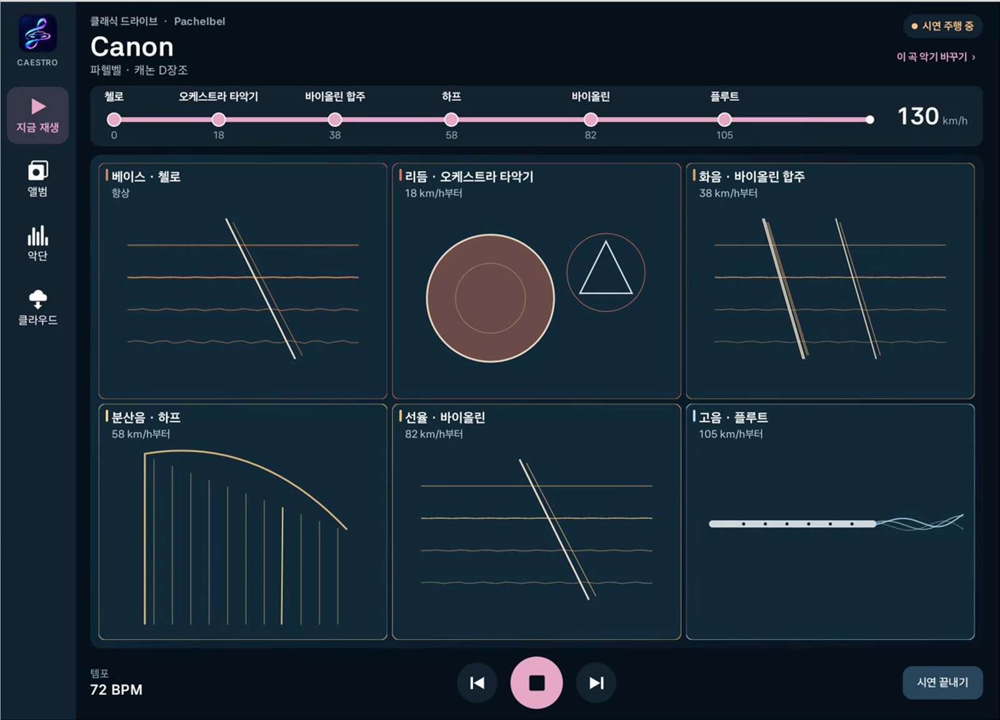

# 카에스트로 Caestro

[](https://hoyadong1.github.io/DriveSoundtrack/)

**Car + Maestro, 내 차가 곧 지휘자.**

속도를 올리면 첼로 위에 악기가 하나씩 들어오고, 브레이크를 밟으면 잦아들고, 핸들을 꺾으면 소리가 기웁니다. 클래식 명곡을 실제 악기 소리로, 내가 꾸린 악단이 연주합니다. Android Automotive(Pleos) 앱입니다.

**[시연 페이지](https://hoyadong1.github.io/DriveSoundtrack/)** · **[APK](apk/홍원택_DriveSoundtrack_release.apk)** · **[📖 위키](https://github.com/hoyadong1/DriveSoundtrack/wiki)**

## 실행

1. [`apk/홍원택_DriveSoundtrack_release.apk`](apk/홍원택_DriveSoundtrack_release.apk)를 Pleos Connect나 Android Automotive 기기에 설치하고 차량 속도 권한을 허용합니다.
2. 곡을 재생하고 달리면 속도에 따라 악기가 더해집니다. **악단** 탭에서 단계마다 악기를 고르고, **클라우드** 탭에서 악보와 악기를 내려받습니다(정차 중).
3. Pleos 에뮬레이터에서는 `.\demo\start-interactive.ps1`로 실행하고, 앱의 **시연 주행** 버튼이나 Virtual Console D단 주행으로 확인합니다. → [자세히](https://github.com/hoyadong1/DriveSoundtrack/wiki/Development#실행)

## 테스트 환경

- Pleos Connect v2.1 에뮬레이터(Android Automotive), Windows 11
- Android Studio, Android SDK API 37(`android.car.jar`), JDK 17 이상, 최소 실행 API 28
- Pleos Vehicle SDK 2.3.2 (Pleos Maven 저장소, [`settings.gradle`](settings.gradle))

```powershell
.\gradlew.bat :app:assembleDebug        # 빌드
.\gradlew.bat :app:testDebugUnitTest    # 단위 테스트 (화음·클릭·조향·악보·악기 음량·앨범·클라우드)
```

release APK를 다시 빌드하려면 저장소에 없는 서명키가 필요합니다. → [빌드·테스트와 검증 범위](https://github.com/hoyadong1/DriveSoundtrack/wiki/Development)

## 클라우드 악보·악기

악보와 악기는 차 밖에서 만들고, 차에서는 내려받아 연주만 합니다. 예시 클라우드는 [`docs/cloud`](docs/cloud)(드보르자크 「라르고」, 트롬본, 핸드팬), 팩 형식과 도구는 [`tools/cloud`](tools/cloud/README.md)에 있습니다.

## 더 보기

| | |
|---|---|
| [기능과 사운드 설계](https://github.com/hoyadong1/DriveSoundtrack/wiki/Features) | 곡과 앨범, 나만의 악단, 속도별 단계, 차량 신호별 연주 방식과 수치 |
| [아키텍처](https://github.com/hoyadong1/DriveSoundtrack/wiki/Architecture) | 구조도, 파일별 역할, 저장소 폴더 |
| [개발과 실행](https://github.com/hoyadong1/DriveSoundtrack/wiki/Development) | 빌드·테스트, 기기·에뮬레이터 실행, 녹화, 검증 범위 |
| [제품 근거](https://github.com/hoyadong1/DriveSoundtrack/wiki/Product-Rationale) | 파워트레인 중립 설계와 전기차 시대의 기회 |
| [버전 이력](https://github.com/hoyadong1/DriveSoundtrack/wiki/Version-History) | 0.1부터 현재까지 |

영상의 소리는 앱이 낸 그대로이며, 검증은 모두 Pleos 에뮬레이터 기준입니다. 앱은 위치·속도 데이터를 저장하거나 보내지 않습니다.

클래식 곡은 저작권이 끝난 원곡을 악보로 직접 입력했습니다. 실제 악기 샘플은 [VSCO 2 Community Edition](https://github.com/sgossner/VSCO-2-CE)(Versilian Studios, CC0)을 다듬어 썼습니다(`tools/samples/`).
