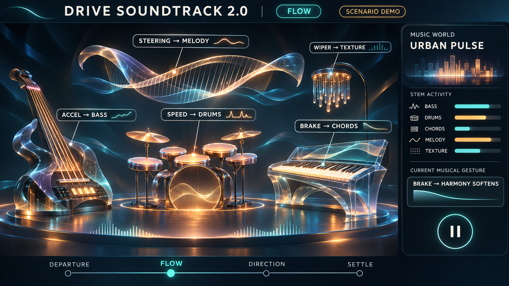

# Drive Soundtrack 2.0 — 차량이 지휘하는 밴드

작성: 2026-11-03 · 상태: 구현 전 개정 기획. [초기 Journey Score 기획](PRODUCT_V2_PLAN.md)의 차량 중심 비주얼을 악기 중심으로 바꾼다.

전기차의 정숙한 실내를 위한 [제품 근거와 첫 구현 범위](EV_PRODUCT_RATIONALE.md)를 함께 참조한다.

이미지는 **시나리오 시연 디자인**이다. 화면에 그려진 악기와 가속·브레이크·조향 입력이 현재 앱에 구현되었다는 뜻은 아니다.

## 제품 원리

차를 화면에 재현하는 대신, 차량 신호가 연주하는 **가상 앙상블**을 보여 준다. 각 신호는 다른 악기의 *연주 방식*에 개입한다. 모든 신호가 각각 독립적인 곡을 틀거나 BPM을 올리면 산만해진다. 기본 곡의 화성·박자·주제는 유지하면서 연주 강약, 음색, 공간감, 악기 진입을 바꾼다.

| 신호 | 맡길 악기 | 들리는 변화 | 정차 화면 표현 | 접근 가능성 |
| --- | --- | --- | --- | --- |
| **속도와 속도 변화** | 드럼 | 킥·스네어의 기본 그루브는 일정. 흐름이 유지되면 하이햇/보조 타악을 천천히 추가 | 드럼 패드와 파트 미터 | AAOS 속도값 **앱에서 검증됨**. 속도 변화는 이 값에서 계산 |
| **가속 페달 압력** | 베이스 | 세게 누를수록 베이스의 음색·어택이 조금 선명해짐. 음량·템포 상한 고정 | 베이스 현의 밝기와 어택 표시 | AAOS 페달 % 속성·권한 문서 **확인**, Pleos 에뮬레이터/앱 전달 **미검증** |
| **브레이크 페달** | 화성 악기(건반/패드) | 페달이 눌리면 화성의 긴장을 풀고 짧게 감쇠. 음악 전체를 갑자기 끊지 않음 | 건반의 잔향과 화음 색이 가라앉음 | Pleos Brake 상태 API와 AAOS 페달 % 속성 **확인**, 연동 **미검증** |
| **조향각** | 선율 악기(현/하프) | 방향에 따라 다음 선율 구절의 진행과 공간감을 아주 조금 변화. 매 순간 음높이를 흔들지 않음 | 선율선의 좌우 곡선 | Pleos SteeringWheel 각도 API·에뮬레이터 조작 **확인**, 앱 연동 **미검증** |
| **방향지시등** | 짧은 퍼커션/응답 악기 | 켜질 때 한 번만 좌/우 응답 구절 예약. 깜빡임을 효과음으로 따라 하지 않음 | 해당 악기가 한 번 빛남 | Pleos TurnSignal API·콘솔 조작 **확인**, 앱 연동 **미검증** |
| **와이퍼 상태** | 셰이커·질감 악기 | 얇은 노이즈/셰이커를 추가하되 전체를 덮지 않음 | 배경 질감 파트가 활성화 | Pleos Wiper API·콘솔 조작 **확인**, 앱 연동 **미검증** |
| **기어 P/D/R** | 악기 아닌 장면 감독 | P는 시작·마무리, D는 연주, R은 음악을 차분하게 축소 | 장면명만 변경 | AAOS 기어 속성·콘솔 조작 **확인**, 앱 연동 **미검증** |

### 추가 후보

- **엔진 RPM:** 내연기관 차에서만 신스의 배음/필터에 쓸 수 있다. AAOS 속성과 제3자 읽기 권한이 문서화되어 있지만, 전기차에는 없으므로 핵심 악기로 배정하지 않는다.
- **EV 에너지 흐름:** 방전/충전 방향이 실제로 제공된다면 패드의 숨결처럼 작게 표현할 수 있다. 회생제동 *설정 단계*를 실시간 회생량으로 오해하지 않는다.
- **실외 조명·와이퍼·공조 풍량:** 음악의 분위기와 악기 질감에는 좋다. 운전자의 조작·차량별 구현 차이가 크므로 멜로디의 핵심 입력으로 삼지 않는다.
- **승객 탑승, 문, 배터리 잔량, 경고등:** 음악적으로 의미가 약하거나 안전 정보이므로 우선 제외한다. 특히 경고·알림 소리를 음악으로 모사하지 않는다.

## 접근성의 경계

AAOS 문서의 `ACCELERATOR_PEDAL_COMPRESSION_PERCENTAGE`와 `BRAKE_PEDAL_COMPRESSION_PERCENTAGE`는 0~100% 값을 제공하고 `READ_CAR_PEDALS` 권한을 요구한다. 하지만 현재 Pleos Virtual Console 안내에는 브레이크·조향 조작은 있고 **가속 페달 조작은 명시되어 있지 않다**. 앱에서 실제 페달 값이 도착하기 전에는 이미지처럼 `ACCEL → BASS`를 라이브 기능이라고 표시하지 않는다. 그 경우 속도 차분값으로 추정한 **가속도**를 베이스에 쓸 수 있으나, 이것을 `가속 페달`이라고 부르지는 않는다.

조향은 Pleos `getCurrentSteeringWheelAngle`/`registerSteeringWheelAngle`을 우선 검증한다. AAOS의 `PERF_STEERING_ANGLE`은 **앞바퀴 각도**로 조향휠 각도와 다르므로 둘을 같은 값으로 혼용하지 않는다. Pleos 샘플 앱은 `READ_CAR_STEERING` 권한을 선언한다. 실제 지원 여부는 capability와 콜백으로 확인한다.

## 음악이 풍부해지는 방식

1. **역할 분리:** 드럼은 시간, 베이스는 추진감, 건반은 긴장/해소, 선율은 방향, 질감은 환경을 맡는다. 모든 신호가 같은 ‘에너지’ 숫자에 합쳐지지 않는다.
2. **화성의 뼈대:** 한 음악 세계에 8마디 주제와 A/B 변주를 둔다. 차량 입력은 다음 박 또는 마디에 예약된다. 페달을 떼도 현재 음이 뚝 끊기지 않는다.
3. **절제된 범위:** 가속 페달을 더 밟아도 볼륨이나 BPM이 무한히 올라가지 않는다. 센서값을 완만하게 다듬고 최대 변화량을 제한한다.
4. **조합의 결과:** 같은 속도라도 완만한 조향+가벼운 제동, 직진+일정 가속, 와이퍼 작동은 서로 다른 악기 조합을 만든다.
5. **신호 결손:** 값이 끊긴 악기만 기본 연주로 돌아간다. 박자와 곡이 멈추지 않으며 `라이브/시나리오/미지원` 출처를 표시한다.

## 화면: 악기 무대

정차/심사용 시나리오 화면 중앙에는 **현재 연주 중인 다섯 악기**가 있다. 각 악기에 신호명, 변화량, 연주 상태를 붙인다. 오른쪽에는 음악 세계, 파트 미터, `브레이크 → 화성이 부드러워짐` 같은 현재 동작의 이유를 보여 준다. 아래에는 Departure/Flow/Direction/Settle의 음악 장면이 이어진다. 3D 차량 모델은 사용하지 않는다.

이 화면은 주행 중 표시를 전제로 하지 않는다. 주행 중 오디오는 백그라운드에서 적응하고, 재생 제어는 차량 미디어 UI·`MediaSession`을 사용한다. 안전·내비 안내를 가리지 않게 오디오 포커스를 따른다. 실제 마켓 출시 화면은 Pleos/AAOS 미디어 앱 심사 기준에 맞춰 별도로 검증한다.

## 먼저 검증할 순서

1. **앱에서 실제 값 읽기:** 속도 외 브레이크 상태, Pleos 조향각, 방향지시등, 와이퍼를 콘솔에서 하나씩 바꾸며 `capability → 현재값 → 콜백 → 앱 화면`을 대조한다.
2. **가속 페달 가능성 확인:** AAOS 속성이 에뮬레이터에 존재하는지, 권한이 허용되는지, 0~100 값이 변하는지 확인한다. 안 되면 시나리오 전용으로 표시하고 라이브 베이스는 속도 변화의 추정치로 구동한다.
3. **세 악기부터 제작:** 드럼·베이스·화성이 서로 다른 원리로 변하고 귀로 구별되는지 먼저 만든다. 이후 조향 선율과 와이퍼 질감을 추가한다.
4. **영상 검증:** 실기 신호 컷과 시나리오 연주 컷을 구분하고, 신호→악기→소리 변화가 같은 시간에 보이게 녹화한다.

## 공식 근거

- [Pleos Vehicle SDK 도메인](https://document.pleos.ai/en/docs/pleos-only/connect-sdk-pleos/Vehicle/intro), [SteeringWheel API](https://document.pleos.ai/docs/pleos-only/connect-sdk-pleos/Vehicle/vehicle/ai.pleos.playground.vehicle.api/steering-wheel/get-current-steering-wheel-angle), [샘플 앱 권한](https://document.pleos.ai/en/docs/pleos-only/tutorial/vehicle-sdk-sample-app)
- [Pleos Virtual Console 조작 목록](https://document.pleos.ai/en/docs/pleos-only/app-test-guide/virtual-console-guide)
- [Android Automotive 차량 속성 및 권한](https://developer.android.com/reference/android/car/VehiclePropertyIds)
- [Pleos 음악 앱 가이드](https://document.pleos.ai/en/docs/pleos-only/vehicle-app-developer-guide/music-audio-app-developement-guide)
